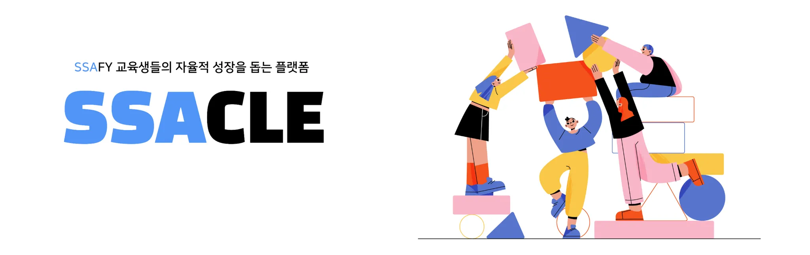
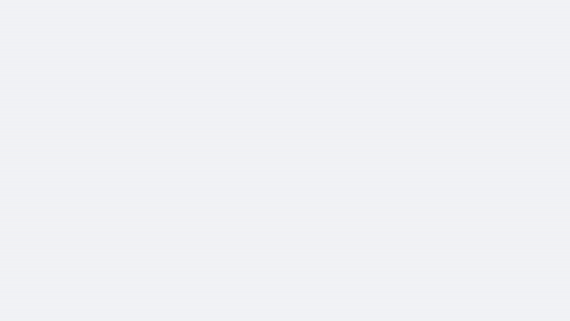
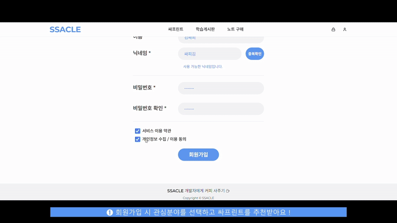
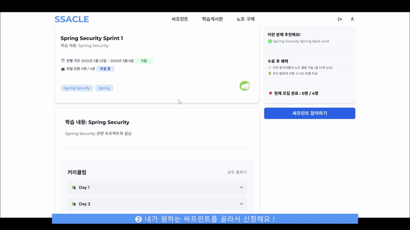
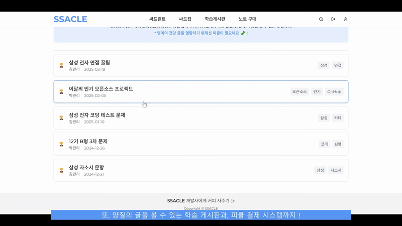
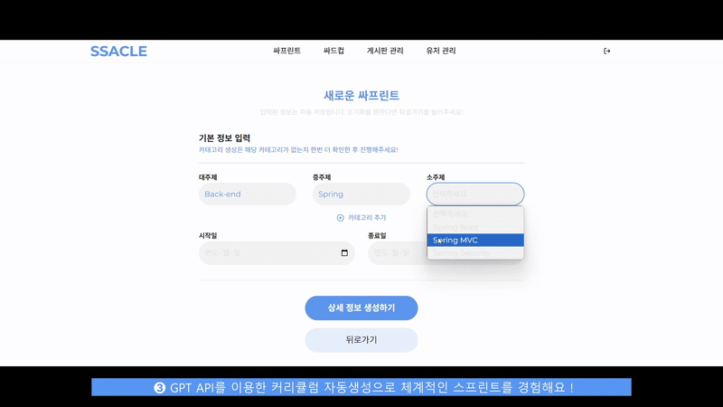

<h3 align="center">✨ SSAFY 교육생들의 자율적 성장을 돕는 스터디 지원 플랫폼, SSACLE ✨</h3>

> 🕰️ **진행 기간** : _2025. 01.06 ~ 2025. 02 .21 **(7주)**_

### ✅ 주요 기능 summary

---

1️⃣ 로그인/회원가입 
- Mattermost를 통한 SSAFY 인증 회원가입

2️⃣ 싸프린트
- 단기간 특정 주제를 빠르고 편리하게 공부할 수 있도록 돕는 기능

3️⃣ 싸드컵
- 팀 단위로 특정 큰 주제를 가지고 깊이 공부할 수 있도록 돕는 기능

4️⃣ 화상 발표 기능
- WebRTC를 이용한 화상시스템

5️⃣ 자유게시판
- 유저들의 자유로운 소통이 가능한 게시판 기능능

6️⃣ 학습게시판
- 질의 응답을 통한 학습 도움 게시판
- 고수준 유저의 양질의 취업, 스터디 관련 정보 제공해주는 명예의 전당

7️⃣ 관리자 기능
- user, 싸프린트, 싸드컵, 게시글 관리리

<!-- # 👨🏻‍💻 함께한 팀원

|  김태영 | 박창조 | 김희수 | 이아영 | 전성호 | 김수현 |
|:---:|:---:|:---:|:----:|:---:|:---:|
|  |  |  |  | | |
| FE | FE, 인프라 | FE | FE | BE | BE | -->

# ✨ 기술 스택

_**👍🏻 Frontend**_

-61DAFB?style=for-the-badge&logo=React&logoColor=white)
-3178C6?style=for-the-badge&logo=typescript&logoColor=white)
-CA4245?style=for-the-badge&logo=reactrouter&logoColor=white)
-06B6D4?style=for-the-badge&logo=tailwindcss&logoColor=white)
-AF001E?style=for-the-badge&logo=zustand&logoColor=white)
-FF4154?style=for-the-badge&logo=reactquery&logoColor=white)

-73BA25?style=for-the-badge&logo=openvidu-browser&logoColor=white) 

**👍🏻 Backend**

-73BA25?style=for-the-badge&logo=openvidu&logoColor=white)

**👍🏻 DevOps**

**👍🏻 CI/CD**

**👍🏻 협업 Tool**

   

# ✨ 시스템 아키텍처

# 🔭 주요 기능

## 1️⃣ 로그인/회원가입
> _""_ 

## 2️⃣ 싸프린트
> _""_ 

## 3️⃣ 싸드컵
> _""_ 

## 4️⃣ 화상 발표 기능
> _""_ 

## 5️⃣ 자유게시판
> _""_ 

## 6️⃣ 학습게시판
> _""_ 

## 7️⃣ 관리자 기능
> _""_ 

# 😎 컨벤션

[모든 컨벤션 확인하러 가기 ↗️](https://past-alder-21d.notion.site/1737b680c33480d294faded6c473e252)

## Branch 명
> FE/feature/JIRA-`{이슈키}`-`{요약}` 

## 주요 Coding 컨벤션
- **컴포넌트 파일 및 폴더** : `PascalCase` 사용
- **변수, 함수, 메소드** : `camelCase` 사용
- **유틸리티/서비스 파일** : `camelCase` 사용
- **상수 변수** : `UPPER_CASE` 사용

# 🗂️ 폴더 구조
[폴더 구조 확인하러 가기 ↗️](https://past-alder-21d.notion.site/Frontend-bd8d69c754e44e95b90287f08f9703ff?pvs=4)
